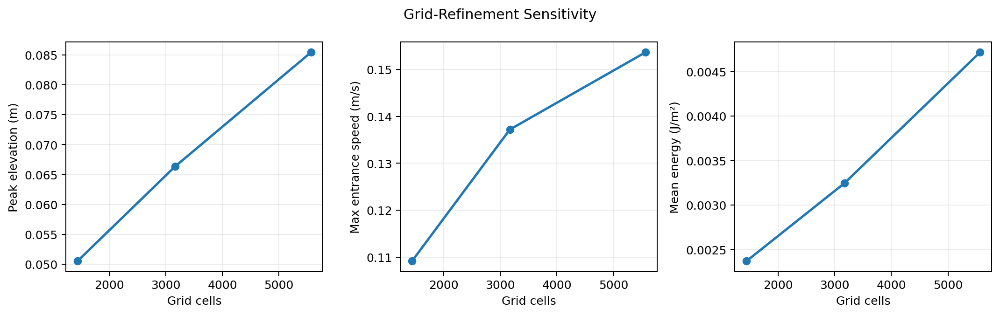
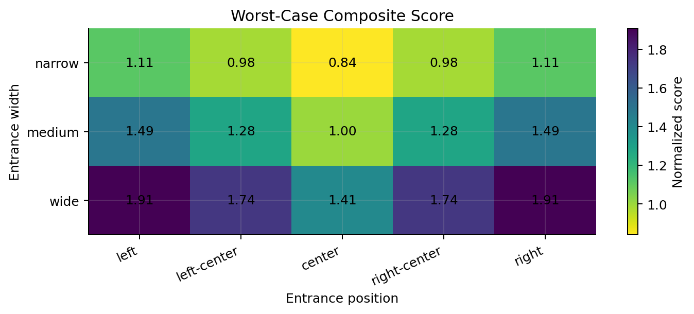
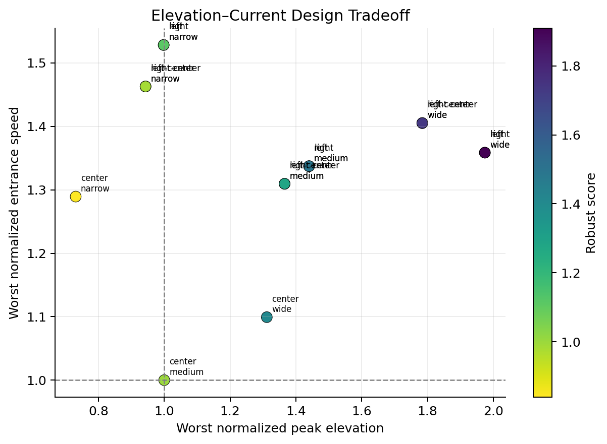
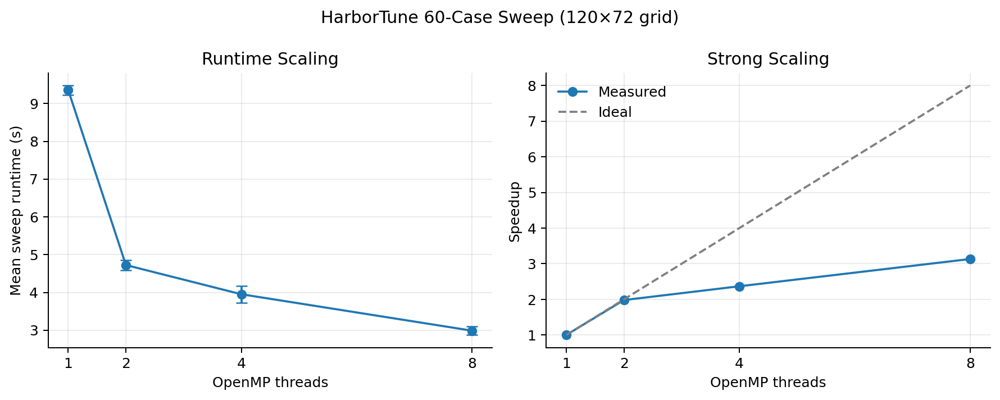
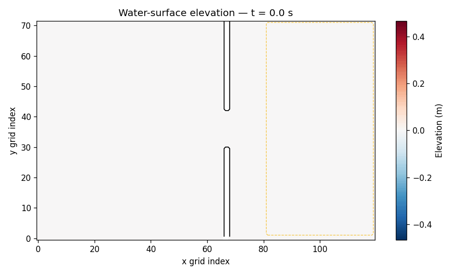

# Reference Results

## Run configuration

These reference results were generated on October 28, 2026, using the default
120 × 72 grid, 140 s simulated duration, optimized C++ build, and the macOS
arm64 development machine. The design sweep used eight OpenMP threads. Scaling
measurements used two repetitions per thread count and should be repeated with
additional trials for the final report.

The raw reference tables are available in `docs/reference_results/`.

## Numerical verification

All six automated verification checks passed:

- measured wave speed: 14.149 m/s;
- theoretical wave speed: 14.007 m/s;
- relative wave-speed error: 1.01%;
- finite stability: passed;
- mirrored-layout elevation, speed, and energy checks: passed; and
- sequential/OpenMP agreement: exact for the recorded metrics.

The grid-refinement study shows that the measured response remains sensitive to
resolution, which is expected from the diffusive first-order scheme. Design
rankings should therefore be interpreted within the selected discretization,
and the refinement results must accompany any physical conclusions.

## Harbor-design sweep

The center/narrow opening ranked first under the predefined worst-case
composite objective:

| Rank | Position | Width | Robust score | Worst normalized elevation | Worst normalized entrance speed |
|---:|---|---|---:|---:|---:|
| 1 | center | narrow | 0.840 | 0.731 | 1.289 |
| 2 | left-center | narrow | 0.985 | 0.943 | 1.463 |
| 2 | right-center | narrow | 0.985 | 0.943 | 1.463 |
| 4 | center | medium | 1.000 | 1.000 | 1.000 |
| 5 | left/right | narrow | 1.112 | 0.998 | 1.528 |

Relative to the center/medium reference, the center/narrow design reduced its
worst normalized peak elevation to 0.731 while increasing worst normalized
entrance speed to 1.289. This result supports the proposed elevation-current
tradeoff: a layout that limits interior elevation can concentrate flow through
the entrance.

Wider openings generally produced higher worst-case composite scores in this
idealized geometry. Left/right mirror pairs produced identical scores after
grid-symmetric geometry construction, as required by the verification model.

## OpenMP performance

The complete 60-case sweep produced the following repeated timing results:

| Threads | Mean time (s) | Speedup | Efficiency |
|---:|---:|---:|---:|
| 1 | 9.355 | 1.000 | 1.000 |
| 2 | 4.725 | 1.980 | 0.990 |
| 4 | 3.952 | 2.367 | 0.592 |
| 8 | 2.987 | 3.132 | 0.391 |

Two threads nearly halved runtime. Additional threads continued to reduce total
time, but efficiency decreased because of memory contention, scheduling costs,
and the finite number of simulations. These measurements support the parallel
hypothesis while also showing the expected departure from ideal strong scaling.

## Example transient simulation

The reference center/medium pulse simulation remained stable and reported:

- peak protected elevation: 0.1509 m;
- maximum entrance speed: 0.2766 m/s; and
- mean protected energy: 0.01432 J/m².

## Interpretation limits

These results compare controlled numerical layouts and do not identify a safe
real-world harbor. The ranking depends on the idealized geometry, constant
depth, wave set, discretization, and equal metric weights. Higher-order methods,
site-specific bathymetry, nonlinear processes, uncertainty analysis, and
professional engineering review would be required before drawing conclusions
about an actual location.

