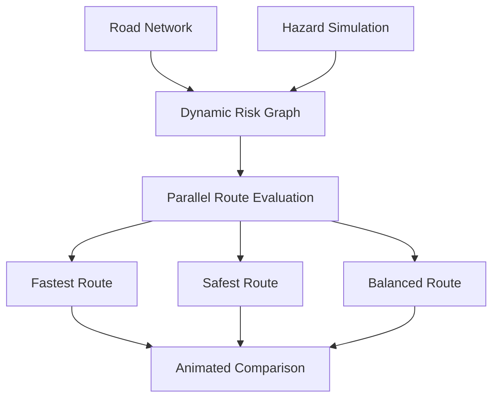

# CSCI 596 Final Project - Complete Context and Continuation Specification

## Purpose of this file

This document is a context-transfer specification for continuing the CSCI 596 Scientific Computing and Visualization final-project discussion in a new ChatGPT conversation or account.

The new assistant should treat this file as the authoritative summary of all work completed so far. It should not restart the topic-selection process from generic project suggestions. It should preserve the decisions, constraints, terminology, and project directions recorded here and continue from the current decision point.

This document summarizes:

- The professor's original project instructions.
- The user's goals and quality expectations.
- Every major project topic considered.
- The analysis of the user's existing SafeRoute project.
- The GitHub repository and collaboration decisions.
- The PDF artifact created during the discussion.
- The final research-informed narrowing of the three preferred projects.
- The current recommendation and unresolved decisions.

---

## 1. User and course context

The user is Sahil Satasiya, an MS student taking **CSCI 596: Scientific Computing and Visualization** in Fall 2026.

The course has involved scientific-computing assignments using topics such as molecular dynamics, parallel computing, MPI, OpenMP, performance analysis, and visualization. The user cares strongly about producing polished, correct, submission-ready work rather than a minimal implementation.

For the final project, the user wants:

- A project that is genuinely useful and visually impressive.
- A topic that is feasible within the semester.
- A repository that works as a strong job or Ph.D. application portfolio piece.
- A project that does not resemble the first generic answer produced by ChatGPT, Claude, or another LLM.
- A problem and methodology that appear genuinely investigated and intentionally designed.
- A project with scientific-computing substance, measurable results, and a clear hypothesis.
- No unnecessary LLM, chatbot, or agent component added merely to sound modern.
- A design that can be implemented in stages so a complete baseline is guaranteed before stretch features are attempted.

The user expects the assistant to help with topic selection now and later guide the team step by step through planning, implementation, experiments, GitHub organization, presentation preparation, and final documentation.

---

## 2. Professor's official project instructions

### Source file

The professor's instructions were uploaded as:

- `Final.pdf`
- Original uploaded workspace path during the prior conversation: `/workspace/scratch/255a23012627/upload/Final.pdf`
- Original Library identifier: `libfile_e68798b50cb48191a7b82598e1273e59`

The PDF was two pages and titled:

> CSCI596 (Scientific Computing and Visualization) Final Project  
> Anything Related to What You Have Learned in the Class

### Deadlines

| Requirement | Deadline |
|---|---|
| Discuss the topic with the professor during office hours and obtain agreement | Friday, November 20, 2026 |
| Give a brief, approximately one-minute informal presentation | Monday, November 30 or Wednesday, December 2, 2026 |
| Submit the GitHub repository URL through Brightspace | Friday, December 11, 2026 |

For a team project, every team member must submit the identical team-repository URL individually.

### One-minute presentation requirements

The presentation is only an outline. The team must explain:

- What problem is being addressed.
- What methods will be used.
- What results are expected.

The professor stated that students may show only the preliminary GitHub repository during this presentation.

### Permitted project options

#### Option I: Programming

Write a program related to a subject covered in the course. Possible areas include:

- Simulation.
- Molecular dynamics.
- Parallel computing.
- MPI.
- OpenMP.
- CUDA or SYCL.
- Scientific visualization.
- OpenGL.
- Performance optimization.
- Load balancing.
- Cache and memory optimization.

The examples supplied by the professor were only inspiration; students were explicitly asked to develop their own topic. Examples included:

- Improving the parallel molecular-dynamics program `pmd.c`.
- Traversing linked-list cells using Hilbert or Morton curves to improve locality and cache performance.
- Implementing load balancing using movable rigid partition boundaries.
- Creating a metacomputing-enabled MD program using processor grouping and message renormalization.
- Optimizing hybrid MPI + OpenMP MD.
- Writing hybrid MPI + OpenMP + CUDA or SYCL code.
- Extending the OpenGL atom visualization program `atomv.c`.
- Color-coding atomic stress tensors.
- Tracing an atom's trajectory.
- Reducing sphere detail for distant atoms.
- Creating an OpenGL animation for a simulation in the student's discipline.

#### Option II: Research proposal

Write a short research proposal containing a novel extension of a technique learned in the class. It must include:

1. Goal and importance of the larger problem.
2. Specific objectives.
3. Current state of knowledge or previous work.
4. Techniques to be used.
5. Expected results, hypotheses, tests, and broader impacts.

### Guidance specific to MS students

The professor explicitly stated that an MS student should select a compelling project so the GitHub repository becomes a strong showcase for job or Ph.D. applications. The professor also encouraged learning a marketable technology such as SYCL or TensorFlow.

### Current strategic decision

The programming option is strongly preferred over the proposal option because a working program, visualization, reproducible repository, and benchmark results will make a better portfolio artifact.

---

## 3. General quality criteria established during the discussion

The project should demonstrate all of the following:

1. **A meaningful scientific model**  
   It should contain a simulation, numerical method, or scientific visualization rather than only a web interface.

2. **A sequential baseline**  
   Correctness and performance comparisons require an understandable reference implementation.

3. **A legitimate parallel method**  
   Use OpenMP, MPI, CUDA, or SYCL where the workload is naturally parallel rather than inserting parallel technology artificially.

4. **A measurable computational question**  
   Examples include runtime, speedup, efficiency, error, convergence, memory use, workload balance, cache behavior, or GPU divergence.

5. **A falsifiable hypothesis**  
   The project should investigate something that could be supported or contradicted by experiments.

6. **A visual story**  
   The final animation or interactive visualization should show both the scientific process and, where possible, the computational mechanism.

7. **Reproducibility**  
   The final repository should include build instructions, run commands, example inputs, fixed random seeds where appropriate, tests, results, limitations, and scripts for reproducing graphs.

8. **A layered scope**

   - Minimum version: complete, correct, and presentable.
   - Strong version: contains the intended main contribution.
   - Stretch version: attempted only after the core project works.

9. **No inflated claims**  
   Educational wildfire, safety, flood, or evacuation simulations must not be presented as operational forecasting or certified safety systems.

---

## 4. Initial six-topic shortlist

An initial shortlist of six ideas was created.

### 4.1 FireFront-HPC

A parallel wildfire-propagation simulator incorporating wind, terrain, vegetation, moisture, stochastic spread, visualization, MPI/OpenMP, and adaptive load balancing around the moving fire front.

Initial strengths:

- Strong connection to course topics.
- Meaningful real-world problem.
- Excellent animation potential.
- Natural load-balancing challenge.
- Opportunity for Morton/Z-order traversal.

Initial concern:

- A plain cellular-automaton wildfire simulator is not sufficiently unique.

### 4.2 PlumeCast-HPC

A pollution or wildfire-smoke dispersion simulator using an advection-diffusion model, finite differences, ensemble uncertainty, parallel computation, and exposure heatmaps.

Distinctive concept:

- Run uncertain wind scenarios in parallel and report a probability-of-exposure map rather than one deterministic plume.

### 4.3 SafeRoute-Sim

A parallel emergency-evacuation simulator using many agents, spatial grids, changing hazards, congestion-aware route selection, OpenMP, and animated bottleneck visualization.

This idea was later replaced conceptually by the stronger SafeRoute-HPC extension described below.

### 4.4 WaveShield

A parallel shallow-water simulation for tsunami or coastal flooding with MPI halo exchange, OpenMP stencil computation, animated wave propagation, and performance evaluation.

Initial concern:

- A generic tsunami solver is mathematically demanding but not especially original.

### 4.5 OrbitLens-GPU

A GPU-accelerated gravitational-lensing renderer that traces light around a simplified black hole and compares CPU, OpenMP, and CUDA performance.

Initial strengths:

- Exceptional visual impact.
- Strong CUDA portfolio value.

Initial concern:

- A pretty black-hole image alone would not constitute a distinctive research contribution.

### 4.6 BioPattern-GPU

An interactive Gray-Scott reaction-diffusion laboratory with CPU/GPU comparison, automated parameter sweeps, phase maps, and possible pattern classification.

Initial strength:

- Safest route to a polished GPU visualization.

Initial concern:

- Basic reaction-diffusion demonstrations are common; automated parameter-space analysis would be required for originality.

---

## 5. Existing SafeRoute project and proposed extension

### Existing repository

The user has an older project at:

- <https://github.com/HackFriends/SafeRoute>

The old repository contains a basic safety-aware route-planning application for Delhi. Based on its repository description and README, it includes:

- Historical crime data.
- Unsupervised machine learning.
- A `Danger Index` for candidate routes.
- Route comparison using safety, travel time, and distance.
- Crime heatmaps.
- JavaScript/Node.js and Python components.
- Map and location interfaces.

The repository showed only a small number of commits and is best understood as an earlier proof of concept or hackathon-scale project.

### Conclusion about reuse

The existing project is useful as a foundation, but it is not sufficient for CSCI 596 in its current form. Merely changing the crime dataset, modernizing the interface, or adding another machine-learning score would not produce enough scientific-computing novelty.

The recommended transformation was:

## SafeRoute-HPC: Parallel Dynamic Evacuation Routing Under Uncertain Hazards

Instead of ranking routes using a static historical crime score, the new system would repeatedly recompute safe routes while a simulated hazard changes with time.

Possible hazards:

- Wildfire.
- Flooding.
- Smoke or toxic plume.
- Earthquake-related road closures.
- Multiple simultaneous disruptions.

### Proposed workflow

### Possible time-dependent edge cost

\[
C_e(t) = \alpha T_e + \beta R_e(t) + \gamma Q_e(t)
\]

Where:

- \(T_e\) is travel time.
- \(R_e(t)\) is time-dependent hazard risk.
- \(Q_e(t)\) is congestion or capacity cost.
- \(\alpha, \beta, \gamma\) control the safety-versus-speed tradeoff.

### What could be reused

- Map and route-visualization experience.
- Crime-data processing concepts.
- Heatmap concepts.
- The general Danger Index and alternative-route idea.
- Some Python or web-application components, if clean and relevant.

### What must be newly developed

- A dynamic hazard simulation.
- A road-network graph with changing edge risk.
- Dijkstra or A* baseline.
- Multi-objective route optimization.
- OpenMP parallel route or scenario evaluation.
- MPI scenario distribution as a stretch feature.
- Monte Carlo uncertainty experiments.
- Scientific validation.
- Runtime, speedup, efficiency, risk, and rerouting-response benchmarks.
- Reproducible project documentation.

### Academic-integrity and repository decision

The earlier project should be disclosed honestly as prior work. The final CSCI 596 contribution must be substantially new.

The recommended approach is to create a separate repository rather than continuing directly inside `HackFriends/SafeRoute`. The new README should state which concepts or code were reused and which components were developed for CSCI 596.

---

## 6. GitHub setup decisions

### Repository versus GitHub Project

A normal GitHub repository is required because it stores:

- Source code.
- Data and sample inputs.
- README and documentation.
- Tests.
- Results and graphs.
- Images and animations.
- Commit history.
- Issues and pull requests.

A GitHub Project is optional and should be used only as a planning board for issues, pull requests, and milestones.

### Recommended setup order

1. Create one new normal repository.
2. Initialize it with a README.
3. Enable Issues.
4. Invite teammates as collaborators.
5. Create issues for major tasks.
6. Optionally create a GitHub Project board connected to the repository.

### Temporary and final names

Before topic approval:

- `CSCI596-Final-Project`

After finalizing the preferred topic:

- `SparseFront`
- `FireFront-HPC`
- `PhotonQueue`
- `HarborTune`
- `SafeRoute-HPC`

### Suggested Project-board columns

- Backlog.
- Ready.
- In Progress.
- Review / Testing.
- Completed.

### Suggested initial issues

- Finalize project topic.
- Confirm hardware access.
- Write research question and hypothesis.
- Identify validation case.
- Implement sequential baseline.
- Implement first parallel version.
- Develop visualization.
- Create correctness tests.
- Run scaling experiments.
- Produce performance graphs.
- Prepare preliminary presentation.
- Complete README and final results.

### Adding collaborators

For a personal repository:

1. Open the repository.
2. Select **Settings**.
3. In the **Access** section, choose **Collaborators**.
4. Select **Add people**.
5. Search by the teammate's exact GitHub username or email.
6. Select the correct account.
7. Confirm the invitation.
8. The teammate must accept the invitation before pushing.

---

## 7. Created PDF artifact

A polished topic-comparison PDF was created:

- Filename: `CSCI596_Final_Project_Ideas.pdf`
- Latest local path from the original workspace: `/workspace/scratch/255a23012627/output/pdf/CSCI596_Final_Project_Ideas.pdf`
- Generator source: `/workspace/scratch/255a23012627/make_project_ideas_pdf.py`
- Latest verified length: five pages.

The PDF contains:

1. Assignment fit, scope guidance, and professor deadlines.
2. The three strongest initial topics.
3. Three additional alternatives.
4. A side-by-side decision matrix and suggested team decision.
5. A dedicated SafeRoute-HPC extension page.

The SafeRoute-HPC page includes:

- A statement that the user already has a basic SafeRoute repository.
- A clear warning that major redevelopment is necessary.
- A comparison of what the base already provides versus what must be new.
- Scientific-computing contributions.
- Minimum, strong, and stretch scopes.
- A rendered system-flow diagram.

At the user's request, the following sections were removed from page four:

- `Questions to settle in the team meeting`
- `Notes and technical references`

The latest PDF was rendered and visually checked. It had five pages, no clipped content, and no out-of-bounds text.

### Important portability note

The Markdown context file does not contain the binary PDF or the professor's original PDF. When starting a new ChatGPT conversation, attach this Markdown file first and, if the assistant needs to inspect or edit the documents, also attach:

- `Final.pdf`
- `CSCI596_Final_Project_Ideas.pdf`

If further PDF edits are required and `make_project_ideas_pdf.py` is available, attach it as well. If it is not available, the PDF can still be recreated from the content in this specification.

---

## 8. Why the three preferred topics were narrowed again

The user liked the FireFront topic and also had a strong interest in the orbit and wave topics. However, the user correctly observed that most classmates will likely ask an LLM for project ideas, producing many similar suggestions.

The broad ideas were therefore rejected as insufficiently distinctive:

- A basic parallel wildfire cellular automaton.
- A generic CUDA black-hole renderer.
- A generic MPI tsunami solver.

The revised strategy was to give each project:

- A narrow computational question.
- A controlled independent variable.
- Two or more competing algorithms.
- A falsifiable hypothesis.
- Quantitative evaluation.
- A visible computational mechanism.
- A bounded minimum implementation.

The final narrowed versions are **SparseFront**, **PhotonQueue**, and **HarborTune**.

---

## 9. Final narrowed project 1: SparseFront

# SparseFront: Locality-Aware Parallel Processing of Fragmented Wildfire Fronts

## Central insight

A conventional wildfire cellular automaton updates every cell on every time step, even though meaningful activity occurs mainly near the moving fire boundary.

The problem becomes computationally interesting when ember spotting creates isolated fires, turning one continuous front into many disconnected active regions.

The project is therefore not simply a wildfire simulation. It is an investigation of sparse computation, locality, and parallel load imbalance in a dynamically fragmented scientific workload.

## Research question

> Under what fire-front density and fragmentation conditions is a sparse active-front algorithm faster than updating the complete terrain grid?

## Independent variables

- Active-cell percentage.
- Fire-front fragmentation.
- Spot-fire probability.
- Grid dimensions.
- Number of OpenMP threads.
- Spatial ordering strategy.

## Implementations to compare

### Method A: Dense-grid baseline

Update all \(N_xN_y\) cells during every time step.

Approximate work:

\[
O(N_xN_yT)
\]

### Method B: Sparse active frontier

Maintain only currently burning cells and susceptible neighboring cells. Process only that frontier rather than scanning the complete terrain.

### Method C: Locality-aware sparse frontier

Group active cells by spatial tiles or Morton/Z-order before processing. This attempts to preserve cache locality when spot fires fragment the active set.

### Method D: Parallel sparse frontier

Use:

- OpenMP dynamic scheduling.
- OpenMP tasks.
- Per-thread frontier buffers.
- Optional MPI domain decomposition.

## Scientific fire model

Each cell may contain:

- Fuel or vegetation category.
- Remaining fuel.
- Moisture.
- Elevation or slope.
- Wind exposure.
- State: unburned, burning, or burned.

Ignition probability may be based on a product or other controlled combination of:

\[
P_{ignite} = P_0 F_{fuel}F_{wind}F_{slope}F_{moisture}
\]

Ember spotting introduces nonlocal ignition events and controls fragmentation.

## Main hypothesis

> Sparse-front processing will outperform dense-grid processing when the active fraction is small, but an unordered sparse frontier will lose efficiency as fragmentation increases. Spatial binning or Morton ordering should recover part of that performance by improving locality.

## Measurements

- Runtime versus active-cell percentage.
- Runtime versus fragmentation.
- Dense-versus-sparse crossover point.
- Speedup versus OpenMP thread count.
- Parallel efficiency.
- Work handled per thread.
- Load-imbalance metric.
- Memory consumption.
- Cache-miss rate, if hardware profiling is available.
- Correctness using identical seeds.

## Visualization

The animation should display:

- Burning and burned regions.
- Wind direction.
- Terrain or fuel.
- Spot fires.
- Cells or tiles currently being processed.
- Optional thread or partition ownership colors.

Displaying computational activity is important because it makes the dense-versus-sparse distinction visible.

## Minimum version

- Synthetic terrain.
- Wind, slope, fuel, moisture, and ember spotting.
- Dense sequential simulator.
- Sparse sequential simulator.
- OpenMP sparse implementation.
- Correctness comparison.
- Runtime experiments.
- Animated visualization.

## Strong version

- Tile-binned or Morton-ordered frontier.
- Dynamic OpenMP task scheduling.
- Controlled fragmentation experiments.
- Detailed crossover analysis.
- Hardware-counter profiling.

## Stretch version

- MPI domain decomposition.
- Dynamic repartitioning.
- Real terrain or vegetation input.
- CUDA or SYCL implementation.

## Main risks

- Attempting excessive fire realism.
- Concurrent duplicate insertion into the active frontier.
- Nondeterminism caused by parallel random-number generation.
- Incorrectly comparing implementations that do not perform identical simulation work.

## Scope protection

This must be described as an educational computational model, not an operational wildfire forecast.

## Professor pitch

> We propose to investigate when a sparse active-front wildfire simulation is computationally preferable to conventional dense-grid updates. The simulation will incorporate wind, terrain, fuel, moisture, and ember-driven spot fires. Because spotting fragments the active fire front, it can reduce cache locality and create irregular parallel workloads. We will compare dense-grid processing, sparse-front processing, and spatially ordered sparse processing using OpenMP, with MPI as a possible extension. We will evaluate runtime, scaling, workload imbalance, memory use, and the crossover point at which each method becomes advantageous. The animation will display both wildfire propagation and the cells or tiles actively processed by the algorithms.

## Why it is distinctive

- The research problem is the algorithmic crossover, not merely fire animation.
- Fragmentation is a controlled experimental variable.
- Morton ordering has a concrete role tied to locality.
- The project connects directly to the professor's examples without copying them.
- It can produce useful results even if the original hypothesis is partly wrong.

---

## 10. Final narrowed project 2: PhotonQueue

# PhotonQueue: Divergence-Aware GPU Ray Tracing Near a Black Hole's Photon Sphere

## Central insight

In a naive GPU black-hole ray tracer, one thread traces one pixel's ray. Rays do not require equal work:

- Some quickly escape.
- Some quickly fall into the black hole.
- Some pass close to the photon sphere and orbit many times.
- Some require smaller numerical steps for accuracy.

GPU threads in a warp execute together. When rays have very different lifetimes, completed lanes remain inactive while the longest ray continues. The project studies that workload divergence rather than merely generating a black-hole image.

## Research question

> Can rays be classified by predicted computational difficulty before numerical integration and grouped to reduce GPU warp divergence without changing the final rendered image beyond a controlled error tolerance?

## Implementations to compare

### Method A: Naive pixel-order CUDA

Adjacent pixels are mapped directly to adjacent threads.

### Method B: Difficulty-bucketed rays

Estimate difficulty using features such as:

- Initial impact parameter.
- Distance from the critical photon-ring region.
- Initial direction.
- Predicted closest approach.

Place rays into categories such as:

- Easy escape.
- Capture.
- Near-critical, long-lived.

Then execute rays with similar expected workloads together.

### Method C: Active-ray compaction

After a fixed number of integration steps, remove terminated rays and compact surviving rays into a new queue.

## Main hypothesis

> Difficulty-based grouping will improve GPU utilization near the photon ring because threads within a warp will have more similar integration lengths.

## Measurements

- Total rendering time.
- Integration steps per ray.
- Ray-lifetime distribution.
- Warp execution efficiency.
- Branch efficiency.
- CPU versus CUDA speedup.
- Naive CUDA versus bucketed CUDA speedup.
- Pixel error or image difference.
- Performance versus resolution.
- Performance versus numerical tolerance.

## Visualization

Produce both:

1. The rendered black-hole or lensing image.
2. A computational-cost image in which every pixel is colored by:
   - Integration-step count.
   - Predicted difficulty.
   - Escape, capture, or orbit classification.

This reveals that the photon ring is not only visually interesting but computationally expensive.

## Minimum version

- Simplified Schwarzschild black hole.
- CPU RK4 integrator.
- CUDA integrator.
- Naive versus bucketed scheduling.
- Step-count heatmap.
- Runtime and image-error comparison.

## Strong version

- Active-ray compaction.
- Adaptive step sizes.
- GPU profiling.
- Difficulty-prediction study.
- Parameterized camera or accretion-disk visualization.

## Stretch version

- Persistent-thread work queue.
- Kerr black-hole rotation.
- More sophisticated ray reordering.
- Interactive visualization.

## Main risks

- Requires dependable NVIDIA GPU access.
- Highest mathematical difficulty of the three projects.
- Numerical errors may create plausible but incorrect images.
- Profiling and optimization can be hardware-specific.

## Why it is distinctive

The contribution is GPU workload organization and divergence reduction, not a generic black-hole renderer.

---

## 11. Final narrowed project 3: HarborTune

# HarborTune: Parallel Inverse Design of Breakwaters for Wave-Resonance Suppression

## Central insight

A generic project asks what happens when a tsunami reaches a coastline. HarborTune instead asks which simplified protective geometry reduces wave amplification over a range of incoming wave periods.

Harbors can resonate when an incoming wave period approaches a natural period of the basin. Repeated reflection can amplify and prolong motion within the harbor.

The project converts forward simulation into a small inverse-design problem.

## Research question

> Which simplified breakwater position, gap width, and orientation minimize interior resonance amplification across a range of incoming wave periods?

## Design variables

- Breakwater position.
- Opening or gap width.
- Orientation.
- Optional porous-damping coefficient.
- Optional basin depth or slope.

## Methodology

1. Construct a simplified two-dimensional harbor.
2. Implement a finite-difference shallow-water solver.
3. Apply incoming sinusoidal waves over a frequency range.
4. Record water-surface elevation at interior monitoring points.
5. Calculate amplification and frequency response.
6. Run many candidate geometries in parallel.
7. Rank designs using resonance reduction and an optional construction-size penalty.

## Parallel structure

Candidate geometry and frequency combinations are independent.

For example:

\[
40\text{ designs} \times 50\text{ frequencies} = 2{,}000\text{ simulations}
\]

Parallel options:

- OpenMP parameter sweep.
- MPI distribution of design-frequency combinations.
- CUDA acceleration within each wave simulation.

## Main hypothesis

> The breakwater geometry that performs best for one wave period will not necessarily minimize amplification across a broader frequency range. A robust design should optimize the complete frequency-response curve rather than a single scenario.

## Measurements

- Maximum interior amplification.
- Frequency-response curve.
- Resonant-period estimates.
- Runtime per simulation.
- Parallel throughput.
- Speedup and parallel efficiency.
- Best design for one frequency.
- Best robust design across a range.
- Error against an analytical rectangular-basin case.

## Visualization

- Animated wave field.
- Standing-wave patterns inside the harbor.
- Frequency-versus-amplification curve.
- Grid of candidate breakwater geometries.
- Before-and-after comparison.
- Optimization landscape over gap width and position.

## Minimum version

- Rectangular harbor.
- Linear shallow-water equations.
- Sequential solver.
- OpenMP parameter sweep.
- Two design variables.
- Frequency sweep.
- Analytical validation.
- Best-versus-worst animation.

## Strong version

- MPI parameter sweep.
- Variable bathymetry.
- Porous breakwater.
- Multiple observation points.
- Robust multi-frequency objective.

## Stretch version

- CUDA solver.
- Irregular harbor geometry.
- Real bathymetry.
- Multi-objective Pareto analysis.

## Main risks

- Numerical stability and boundary conditions.
- More mathematical work than SparseFront.
- Care is needed to distinguish numerical artifacts from resonance.

## Why it is distinctive

The contribution is parallel inverse design and robust frequency-response optimization, not merely tsunami animation.

---

## 12. Final comparison of the three narrowed projects

| Criterion | SparseFront | PhotonQueue | HarborTune |
|---|---:|---:|---:|
| Distinctive research question | 5/5 | 5/5 | 5/5 |
| Scientific-computing depth | 5/5 | 5/5 | 5/5 |
| Visual impact | 5/5 | 5/5 | 4/5 |
| CPU-only feasibility | 5/5 | 3/5 | 5/5 |
| Mathematical difficulty | Medium | High | High |
| Implementation risk | Medium | High | Medium-high |
| Validation difficulty | Medium | High | Medium |
| Natural parallelism | 5/5 | 5/5 | 5/5 |
| Portfolio value | 5/5 | 5/5 | 5/5 |
| Strongest characteristic | Best overall balance | Most visually striking | Most research-like |

---

## 13. Current recommendation and decision state

### Preferred project

**SparseFront** is currently the strongest recommendation.

Reasons:

- It matches the user's interest in FireFront.
- It is the most feasible of the three narrowed topics.
- It has a precise and non-generic research question.
- It naturally uses OpenMP and can extend to MPI.
- It directly connects to the professor's interest in Morton/Hilbert ordering, locality, and load balancing.
- It offers strong scientific and computational visualizations.
- It can be completed without guaranteed GPU access.
- It has clear minimum, strong, and stretch versions.

### Alternative if GPU access and CUDA experience are strong

**PhotonQueue** is the most visually memorable and potentially the strongest GPU portfolio project, but it has the greatest mathematical and correctness risk.

### Alternative if the team prefers numerical PDEs and inverse problems

**HarborTune** is the most academically research-oriented, particularly because it performs design optimization rather than only forward simulation.

### SafeRoute status

SafeRoute-HPC remains a credible fourth direction because an existing base is available. However, after the final narrowing, the main active comparison is SparseFront versus PhotonQueue versus HarborTune.

### No final team selection yet

The user personally prefers FireFront/SparseFront but has not yet recorded a final team decision. The next assistant should not claim the topic is finalized until the user confirms team agreement and professor approval.

---

## 14. Immediate next steps

The recommended next conversation should proceed in this order:

1. Confirm which teammates are participating.
2. Confirm available hardware:
   - CPU core count.
   - Access to the university cluster.
   - MPI availability.
   - NVIDIA GPU and CUDA availability.
3. Share the narrowed three-topic comparison with the team.
4. Select one topic, preferably SparseFront unless team skills strongly favor another.
5. Prepare a one-paragraph topic-approval message for the professor.
6. Create the new GitHub repository.
7. Write the initial README containing:
   - Problem statement.
   - Research question.
   - Hypothesis.
   - Methods.
   - Expected results.
   - Minimum and stretch scopes.
8. Create issues and assign teammates.
9. Implement the sequential correctness baseline before adding parallelism.

---

## 15. Instructions for the next assistant

When this file is uploaded into a new conversation, the assistant should:

1. Acknowledge that it has loaded the context.
2. State the current decision point: the team must choose among SparseFront, PhotonQueue, and HarborTune, with SparseFront currently recommended.
3. Preserve the exact narrowed research questions rather than reverting to broad versions.
4. Avoid suggesting generic chatbot, LLM, or agent components.
5. Avoid presenting an ordinary wildfire CA, black-hole renderer, or tsunami animation as sufficiently novel.
6. Keep minimum, strong, and stretch scopes separate.
7. Treat correctness and validation as mandatory.
8. Be explicit about assumptions and hardware dependencies.
9. Do not claim operational safety, disaster forecasting, or scientific accuracy beyond the implemented model.
10. Remember that the professor must approve the topic by November 20, 2026.
11. Remember that the preliminary one-minute presentation occurs November 30 or December 2, 2026.
12. Remember that the GitHub repository URL is due December 11, 2026.
13. If asked to modify the existing PDF, request or use `CSCI596_Final_Project_Ideas.pdf` and preferably `make_project_ideas_pdf.py`.
14. If asked to verify the official instructions, request or use `Final.pdf`.

---

## 16. Research and technical starting points already identified

These references informed the narrowing. They are starting points, not a finished literature review.

### Parallel-programming documentation

- MPI 4.1 Standard: <https://www.mpi-forum.org/docs/mpi-4.1/mpi41-report.htm>
- OpenMP specifications: <https://www.openmp.org/specifications/>
- NVIDIA CUDA Programming Guide: <https://docs.nvidia.com/cuda/cuda-programming-guide/>

### Wildfire

- PyTorchFire, GPU-accelerated differentiable wildfire CA: <https://arxiv.org/abs/2502.18738>
- Fire Spread Modeling using Probabilistic Cellular Automata: <https://arxiv.org/abs/2403.08817>
- PROPAGATOR operational cellular-automata wildfire simulator: <https://doi.org/10.3390/fire3030026>
- NASA FIRMS resources: <https://firms.modaps.eosdis.nasa.gov/academy/>

### Black-hole and photon computation

- GRay, massively parallel GPU ray tracing in relativistic spacetimes: <https://arxiv.org/abs/1303.5057>
- Adaptive Analytical Ray Tracing of Black Hole Photon Rings: <https://arxiv.org/abs/2211.07469>
- GPU optical-photon divergence and thread reordering example: <https://arxiv.org/abs/2608.21396>

### Waves and harbor resonance

- NOAA Center for Tsunami Research benchmark methods: <https://nctr.pmel.noaa.gov/benchmark/index.html>
- NOAA tsunami modeling research: <https://nctr.pmel.noaa.gov/model.html>
- USGS SAFRR tsunami modeling in ports and harbors: <https://pubs.usgs.gov/of/2013/1170/d/>
- USGS coastal tsunami simulation and visualization data: <https://www.usgs.gov/data/simulation-and-visualization-coastal-tsunami-impacts-safrr-tsunami-source>

---

## 17. Final compact state summary

- The official project allows programming or proposal work related to course topics.
- Programming is preferred.
- The GitHub URL is the final deliverable.
- The topic requires professor approval by November 20, 2026.
- A five-page team topic PDF has already been created.
- A separate new GitHub repository is recommended.
- The user has an older SafeRoute project that could be heavily extended but is not sufficient as-is.
- The initial broad topics were refined to avoid generic LLM-generated work.
- The final three are:
  1. **SparseFront** - sparse versus dense wildfire-front computation under controlled fragmentation.
  2. **PhotonQueue** - GPU divergence-aware black-hole ray scheduling.
  3. **HarborTune** - parallel inverse design of breakwaters for resonance suppression.
- **SparseFront is the current recommendation**, but no final team or professor approval has yet been recorded.

End of context-transfer specification.
